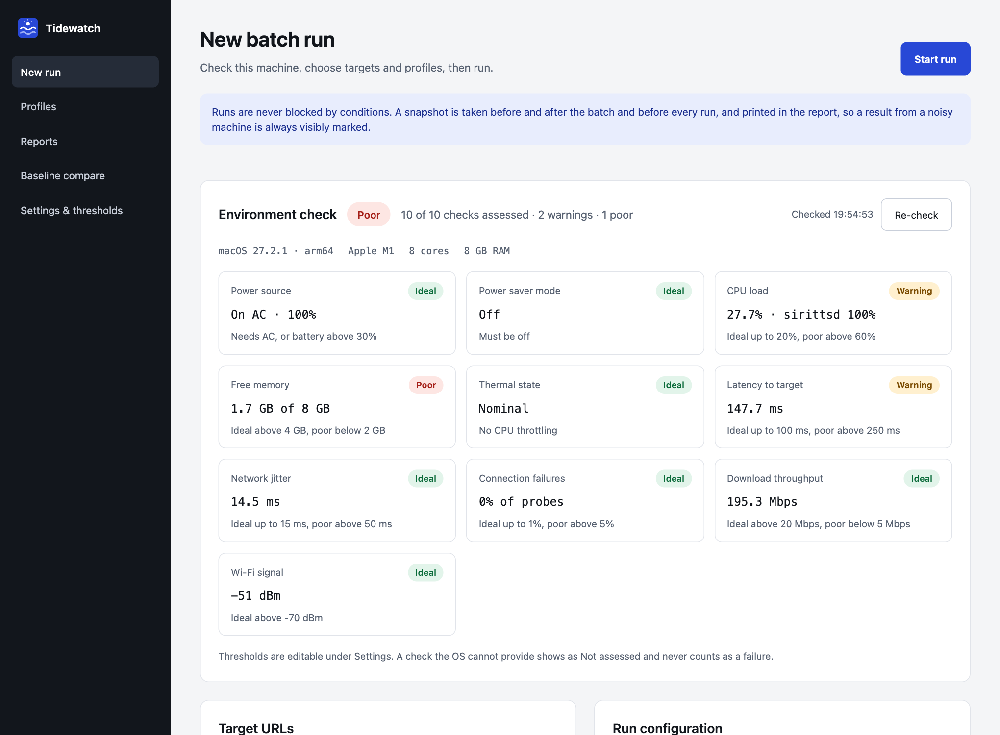
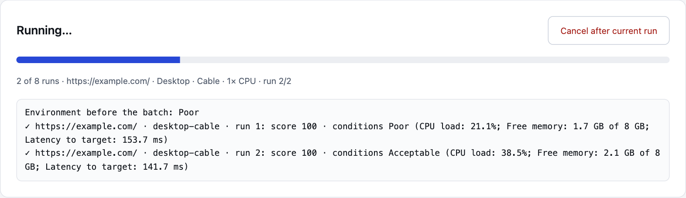
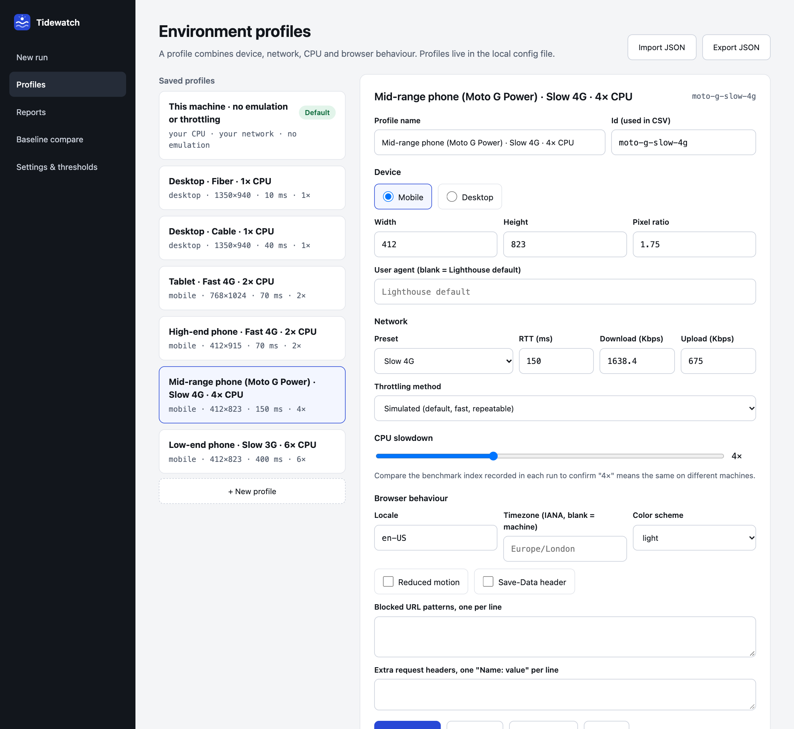
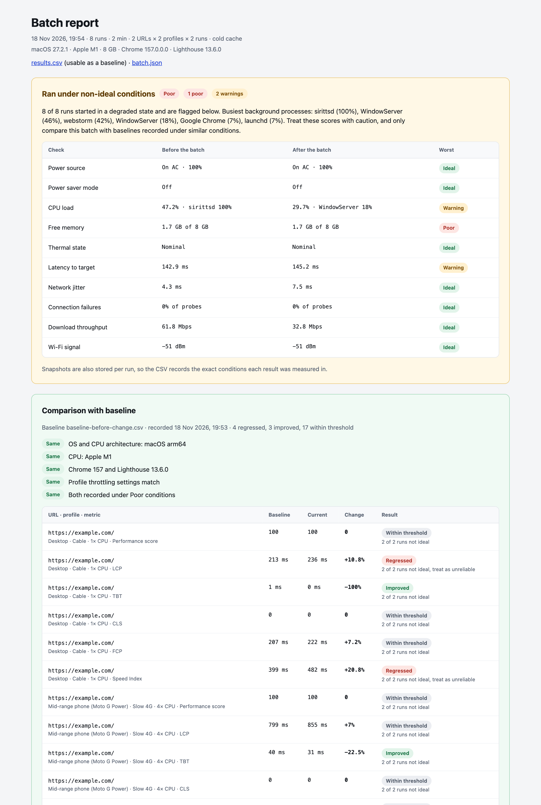
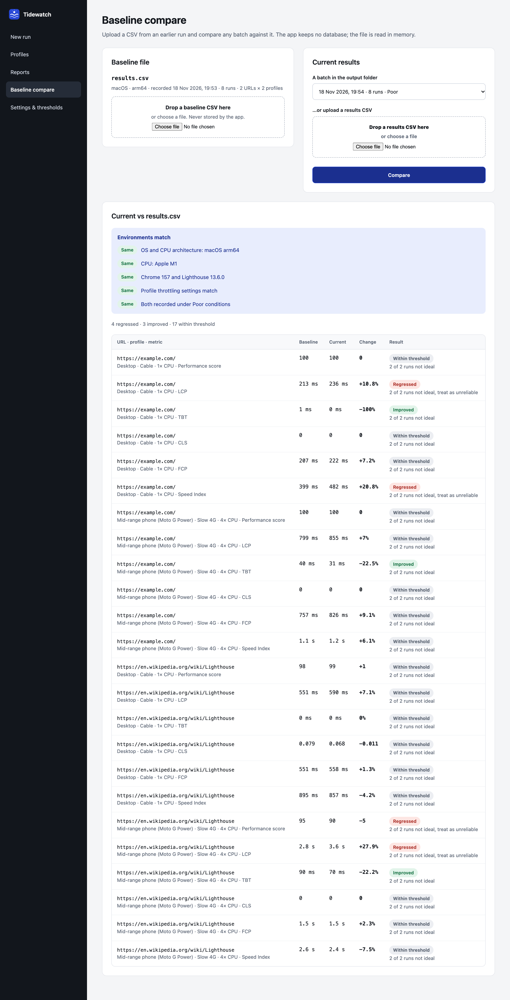
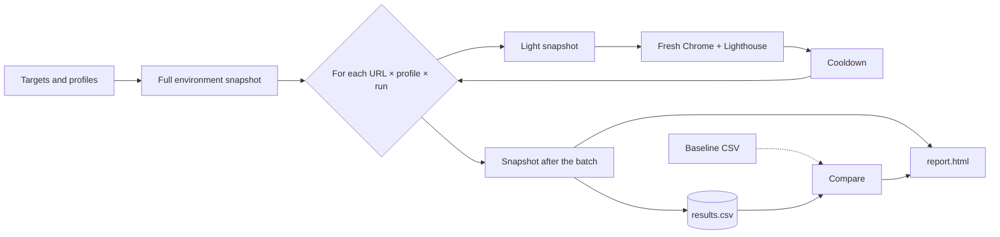

<p align="center">
  
</p>

<h1 align="center">Tidewatch</h1>

<p align="center">
  <b>Lighthouse runs that know the conditions they ran under.</b><br>
  Bulk-test your pages, record how healthy the machine was, and keep a baseline as a plain CSV.
</p>

<p align="center">
  <a href="https://github.com/de-saurabh/tidewatch/actions/workflows/ci.yml"></a>
  
  
  
</p>

<p align="center">
  <a href="#quick-start">Quick start</a> ·
  <a href="#why">Why</a> ·
  <a href="#how-it-works">How it works</a> ·
  <a href="#profiles">Profiles</a> ·
  <a href="#baselines">Baselines</a> ·
  <a href="#cli">CLI</a>
</p>

<p align="center">
  
</p>

---

## Why

A Lighthouse score is only as trustworthy as the machine that produced it. A laptop on battery, a busy CPU,
a thermally throttled chip or a flaky Wi-Fi link can move a score by more than the change you were trying to measure.
Running once and reading one number tells you nothing about *why* it moved.

Tidewatch runs Lighthouse the way you would if you were being careful, and writes down the conditions so you can tell
a real regression from a noisy afternoon.

## What you get

| | |
|---|---|
| **Honest conditions** | Power, power saver, CPU load, memory, thermal state, latency, jitter, connection failures, throughput and Wi-Fi signal are measured before the batch, before every run, and after the batch. Each is graded Ideal, Warning, Poor or Not assessed |
| **Never blocks** | A bad environment doesn't stop the run. It is stamped on the report and in every CSV row, so a result from a noisy machine is always visibly marked |
| **Bulk, serial, repeatable** | URLs × profiles × N runs with a cooldown between runs. Serial on purpose: parallel runs distort each other. Medians, min/max and spread, cold or warm cache |
| **Environment profiles** | A ladder from fiber desktop to low-end phone on Slow 3G, plus a read-only profile that uses **this machine exactly as it is**. Fully customisable: device, network, CPU slowdown, locale, timezone, color scheme, headers, blocked URLs |
| **CSV as the baseline** | No database. Each batch writes a self-describing CSV. Upload one later and new results are compared against it |
| **Comparability warnings** | If the OS, CPU, Chrome or Lighthouse version, throttling or conditions differ from the baseline, the comparison says so before you trust it |
| **Web UI and CLI** | Same engine, same config file. Export the HTML report, CSV or a ZIP of everything |
| **Cross-platform** | macOS, Linux and Windows. A signal the OS can't provide is "Not assessed", never a failure |

## Screenshots

<table>
  <tr>
    <td width="50%"></td>
    <td width="50%"></td>
  </tr>
  <tr>
    <td align="center"><sub><b>Live progress.</b> Every run reports the conditions it started under.</sub></td>
    <td align="center"><sub><b>Profiles.</b> Edit a profile and see the exact Lighthouse settings it produces.</sub></td>
  </tr>
  <tr>
    <td width="50%"></td>
    <td width="50%"></td>
  </tr>
  <tr>
    <td align="center"><sub><b>Report.</b> The conditions banner comes first, then the baseline comparison and results.</sub></td>
    <td align="center"><sub><b>Baseline compare.</b> Upload a CSV, pick a batch, see what regressed.</sub></td>
  </tr>
</table>

## Quick start

You need **Node 22.19+** and **Google Chrome** (or Chromium).

```sh
git clone https://github.com/de-saurabh/tidewatch.git
cd tidewatch
npm install
npm start
```

Open **http://localhost:4173**, add a URL, and press **Start run**. The default profile is *This machine*, so the
first run needs no setup.

## How it works



Nothing is stored inside the app. Each batch is a folder; your history is whatever is in that folder.

## Conditions it checks

| Check | macOS | Linux | Windows | Source |
|---|:-:|:-:|:-:|---|
| Power source and battery | ✓ | ✓ | ✓ | `systeminformation` |
| Power saver | ✓ | ✓ <sup>1</sup> | ✓ | `pmset`, `powerprofilesctl`, `powercfg` |
| CPU load (and the busiest process) | ✓ | ✓ | ✓ | sampled over ~1 s |
| Free memory | ✓ | ✓ | ✓ | `systeminformation` |
| Thermal throttling | ✓ | ✓ <sup>2</sup> | ✗ | `pmset -g therm`, CPU temperature |
| Latency, jitter, connection failures | ✓ | ✓ | ✓ | TCP connect timing to the target |
| Download throughput | ✓ | ✓ | ✓ | one 10 MB download (can be disabled) |
| Wi-Fi signal | ✓ <sup>3</sup> | ✓ | ✓ | `systeminformation` |

<sub><sup>1</sup> needs `powerprofilesctl`. <sup>2</sup> only where the kernel exposes a temperature. <sup>3</sup> macOS may withhold it without location permission.
Anything unavailable is shown as **Not assessed** and does not count against the verdict.</sub>

The overall verdict is **Ideal**, **Acceptable** (any warning) or **Poor** (any poor). Every threshold is editable.

## Profiles

Built in, ordered fastest to slowest. The first is the default.

| Profile | Emulation |
|---|---|
| **This machine** (default) | None. Real CPU, real network, the browser's own user agent. Read-only |
| Desktop · Fiber | 100 Mbps, 10 ms RTT, 1× CPU |
| Desktop · Cable | Lighthouse's desktop preset: 10 Mbps, 40 ms, 1× |
| Tablet · Fast 4G | 9 Mbps, 70 ms, 2× CPU |
| High-end phone · Fast 4G | 9 Mbps, 70 ms, 2× CPU |
| Mid-range phone (Moto G Power) · Slow 4G | Lighthouse's mobile default: 1.6 Mbps, 150 ms, 4× CPU |
| Low-end phone · Slow 3G | 400 Kbps, 400 ms, 6× CPU |

Add, edit, duplicate or delete any profile except *This machine*, and choose a different default on the Profiles page.
Results from *This machine* reflect that hardware, so compare them only with baselines recorded on the same machine.

## Baselines

1. **Run a batch.** It writes `results.csv`.
2. **Keep the CSV** wherever you like. It is the baseline.
3. **Later, upload it** on the New run page or the Baseline compare page. Results are matched by URL and profile, and each metric is
   marked **Regressed**, **Improved** or **Within threshold** using your regression thresholds.

The CSV is self-describing: it carries a schema version, Lighthouse and Chrome versions, OS, CPU, the throttling settings,
and the conditions each run started under. That is what lets the comparison tell you when it can't be trusted.

<details>
<summary>CSV columns</summary>

One row per run, plus one `median` row per URL × profile.

`schema_version, batch_id, timestamp, row_type, url, profile_id, profile_name, run, is_median_run, error,
perf_score, a11y_score, best_practices_score, seo_score, lcp_ms, cls, tbt_ms, fcp_ms, speed_index_ms, transfer_kb, requests,
runs_ok, runs_degraded, perf_score_stddev, lcp_min_ms, lcp_max_ms,
env_verdict_start, env_verdict_batch_before, env_verdict_batch_after,
on_ac, battery_pct, power_saver, cpu_load_pct, free_mem_gb, thermal, latency_ms, jitter_ms, packet_loss_pct,
download_mbps_before, download_mbps_after, os, os_version, arch, cpu_model, cpu_cores, ram_gb,
chrome_version, lighthouse_version, benchmark_index, form_factor, throttling_method, rtt_ms, download_kbps,
cpu_slowdown, cache_mode, run_warnings`

</details>

## CLI

Same engine and config as the UI.

```sh
node src/cli.js env                                   # check this machine
node src/cli.js profiles                              # list profiles
node src/cli.js run --url https://example.com         # uses the default profile
node src/cli.js run --url https://example.com --profile desktop-cable --profile moto-g-slow-4g --runs 5
node src/cli.js run --url https://example.com --baseline output/<batch>/results.csv
node src/cli.js compare --baseline old.csv --current new.csv
```

Press Ctrl+C during a run to stop after the current run. Partial results are still saved.

## Output

Each batch is a folder under `output/`:

| File | What |
|---|---|
| `report.html` | Summary. Opens with the conditions banner and before/after values for every check |
| `results.csv` | The baseline-ready record |
| `batch.json` | Full structured record, including the environment snapshots |
| `runs/*.report.html`, `runs/*.json` | The native Lighthouse report and result for every run |

## Configuration

`tidewatch.config.json` (created on first start; override the path with `TIDEWATCH_CONFIG`) holds profiles, environment thresholds,
regression thresholds, run defaults and probe settings. Edit it by hand or in the UI.

## Notes and limits

- Public `http(s)` URLs only. No authentication flows yet.
- Uses the Chrome installed on the machine. Its version is recorded per row and checked against the baseline.
- The throughput check downloads 10 MB from a public speed-test endpoint. Set `probes.throughputUrl` to `null` to disable it.
- Developed and hand-tested on macOS. The Linux and Windows probes are exercised by CI but have not been tried on real desktops yet.
- Windows exposes no reliable thermal signal, so that check is Not assessed there.
- The dark color scheme option relies on a Chrome flag that has not been verified.
- The server listens on `127.0.0.1` only and rejects other `Host` and `Origin` headers.

## Development

```sh
npm test         # unit tests
npm run smoke    # a real Lighthouse run against a local page (needs Chrome)
```

CI runs both on Ubuntu, macOS and Windows with Node 22 and 24.

```
src/
  env/         snapshot collection, per-OS probes, verdict engine
  runner/      Lighthouse runner, profile mapping, batch orchestration
  report/      CSV, baseline comparison, HTML report
  server.js    local API and static UI
  cli.js
public/        the web UI (no build step)
test/  scripts/
```
